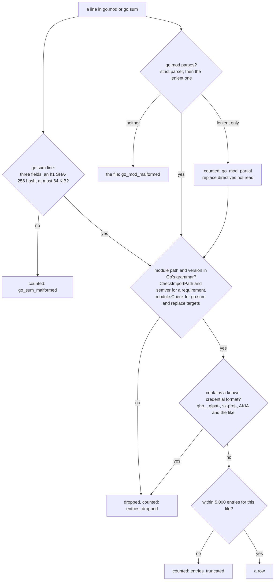

# `go_modules`

One row per Go module version that a project on this host requires in its `go.mod`, records a hash for in its `go.sum`, or both. It is an inventory of declarations and checksum records: what each project's `go.mod` declares and what its `go.sum` records. It does not resolve the dependencies a build uses, and its hashes are records from `go.sum`, not a verification of any installed content. Security uses it to hunt for vulnerable versions when an advisory is published, the developer tools team uses the range of versions in use, and IT and operations use it to clear old versions off machines and to make sure the versions in use can be fetched from the approved module proxy.

Core osquery has no Go module reader. Fleet orbit's `go_binaries` reads the build information embedded in binaries under `~/go/bin` and reports each binary's main module only, so it answers which tools a user installed rather than which modules a project depends on.

## What a row establishes

A row records what a file states, not which version a build uses. Treat it as a candidate to confirm, and confirm it with the go command in that project, such as `go list -m all` or `govulncheck`.

- A `go.mod` requirement declares a minimum version. Minimal version selection can choose a higher one when another module requires it, so a requirement can name a version older than the one compiled in.
- At `go 1.17` and higher, `go.mod` holds an explicit requirement for every module that provides a package to the build. Below `go 1.17`, an indirect dependency appears only when it would otherwise be selected at a different version, so a module the build uses can be absent from `go.mod` and present only in `go.sum`.
- `go.sum` can hold hashes for several versions of one module, and for versions that are no longer needed after an upgrade. `go mod tidy` removes them, and a checkout that was never tidied keeps them.
- A `go.sum` record that hashes only a version's `go.mod` file, shown by `go_mod_hash_recorded = 1` with `module_hash_recorded = 0`, means the go command read that version's requirements during version selection. It does not mean the module's contents were downloaded.
- A build fetches the `go.mod` file of each module version in its module graph and the `.zip` of each module that provides a package, and `go.sum` holds a hash of each. The versions with `module_hash_recorded = 1` or `go_mod_hash_recorded = 1` are therefore the set a module proxy must serve for the project, plus any version an upgrade made unnecessary that `go mod tidy` has not removed.

A query for an advisory therefore produces both kinds of error even when `scan_complete = 1`: a false positive for a requirement or hash older than the version built, and a false negative for a module whose build version appears in neither file. `scan_complete` says the files were read in full, not that they describe the build.

## Sources

The table reads the projects that clients record, then two files in each project. It never walks a directory tree.

| Client | Where it records projects |
| --- | --- |
| VS Code, Code - Insiders, Cursor, Windsurf, VSCodium | the `folder` of each `workspaceStorage/*/workspace.json` under the editor's application-support directory |
| GoLand, IntelliJ IDEA, PyCharm and every other JetBrains IDE | the keys of `RecentProjectsManager` in `JetBrains/<product><version>/options/recentProjects.xml` under the application-support directory |
| Claude Code | the keys of `projects` in `~/.claude.json` |
| Codex | the `[projects."<path>"]` tables in `~/.codex/config.toml` |

The lists are read in that order, which is the order Go developers use the clients: the [2025 Go Developer Survey](https://go.dev/blog/survey2025) puts VS Code at 37% and GoLand at 28%, and the coding agents come after the editors. The order decides which projects are dropped when the project cap is reached.

The application-support directory is `~/Library/Application Support` on macOS, the account's roaming application data on Windows, and `~/.config` on Linux, plus the snap and flatpak locations for the forks that ship in those formats. On Windows a redirected roaming directory is followed when it is inside the profile and reported, not read, when it is outside.

A project-list file that is absent is silent, because most accounts do not use every client. A list file that exists and cannot be read is reported in a warning row for the user, and that includes a list file the read refuses because it is a symlink: the refusal stays in force, and the projects that list records are reported as missing rather than treated as never recorded.

JetBrains documents the per-product configuration directory on each platform but not the `recentProjects.xml` inside it, so the format read is the one GoLand 2026.2 and PyCharm 2026.2 wrote on the development machine. A project path is written with placeholders: `$USER_HOME$` is expanded to the account's home, the IDE's own hidden scratch workspace under `$APPLICATION_CONFIG_DIR$` is skipped, and any other placeholder is reported as an unusable path rather than guessed at. The Toolbox app's own directories beside the products are not read. A `recentProjects.xml` that parses but is not laid out that way, such as one from a release that renames the `RecentProjectsManager` component or its `additionalInfo` map, is reported as an unreadable project list rather than read as a list with no projects. The two forms IntelliJ writes for an empty list, no component and a component with no `additionalInfo`, are silent.

In each recorded project the table reads `go.mod` and `go.sum` at the project root. A project with neither file is silent: most recorded projects are not Go projects, and a project list keeps directories that have since been deleted.

### What the project lists do not cover

- A project that the user never opened in one of the clients above. A Go project worked on only from a terminal is not listed.
- A module that is not at the project root. A repository whose `go.mod` lives in a subdirectory contributes nothing.
- The modules a `go.work` names: workspace discovery is not supported in this version. A project with a `go.work` at its root is counted in a `go_workspace_unsupported` row, whether or not it has a root `go.mod`, so a workspace never looks like a project with no Go dependencies. When the root has a `go.mod`, the root module is listed.
- A multi-root VS Code workspace, which records a `.code-workspace` file instead of a folder.
- A recorded project outside the account's home, on another host, or recorded as an unusable path. Each is counted in a `warning` row and not read.
- A recorded project stored somewhere other than this machine's disk: in a cloud storage provider's folder, on a network filesystem, or with a module file whose content is held by a cloud provider. The provider or the server is where such a project is inventoried, so it is counted in a `warning` row and not read.

## Columns

| Column | Content |
| --- | --- |
| `module_path` | the module path |
| `version` | the version the files state: a minimum for a requirement, a hashed version for a `go.sum` record |
| `mod_relationship` | `direct` or `indirect` when `go.mod` requires this version; empty when it does not |
| `replace_module`, `replace_version` | the module and version a `go.mod` `replace` directive substitutes for this requirement |
| `replace_local` | `1` when a `replace` directive substitutes a local directory |
| `project_module` | the project's own module path, from the `module` line of its `go.mod`; empty when the project has no `go.mod` |
| `project_path` | the absolute path of the project directory; empty on a warning row about the user rather than one project |
| `user` | the user's account name, as osquery's `users` table reports it |
| `uid` | the `uid` column of osquery's `users` table, as core osquery's per-user tables publish it, so `JOIN users USING (uid)` works; on Windows osquery fills it with the last component of the SID, which two accounts can share |
| `user_id` | the uid on macOS and Linux, the whole SID on Windows; empty when it is in neither form |
| `module_hash_recorded`, `go_mod_hash_recorded` | `1` when `go.sum` has a line hashing this version's contents, or its `go.mod` file; `0` when it has none |
| `module_hash`, `go_mod_hash` | the hash on that line, as `h1:` and a base64 SHA-256 digest; empty when its `_recorded` column is `0`, or when two lines record different hashes |
| `scan_complete` | `1` (yes) when the project's `go.mod` and `go.sum`, whichever exist, were read in full with nothing left out; `0` (no) otherwise, and on every diagnostic row |
| `warning` | empty on a module row; on a diagnostic row, a fixed sentence for the kind of problem, followed in brackets by whichever details apply (`count=`, `limit=`, `line=` or `reason=`), and prefixed with `go.mod: ` or `go.sum: ` when the problem is in one module file, so `warning LIKE 'go.sum:%'` selects them |

### Column order

The columns run in the order a query writer needs them: the module version a hunt filters on, how `go.mod` declares it, the project and user it was found for, what `go.sum` records for it, and whether the project's listing is complete. Core osquery's package tables lead with the item the same way: `deb_packages` and `npm_packages` start with `name` and `version`, and `vscode_extensions`, a per-user inventory like this one, starts with `name`, `uuid` and `version` and has `uid` near the end. `SELECT *`, `.mode line` and fleet consoles show columns in declared order, so the values a query filters on come first and the long ones, the hashes and `warning`, come last. `mcp_servers` follows the same order: the server, what it runs, the file and user it was found for, then `scan_complete` and `warning`.

The two files are matched on the exact module path and version, and the hash columns hold what `go.sum` recorded for that module and version. The go command hashes what it downloads, so a requirement that a `replace` directive sends to another module usually has empty `go.sum` columns, and the replacement is listed as its own row with an empty `mod_relationship`; a requirement replaced by a local directory usually has none, because nothing is downloaded. Neither is guaranteed. Adding a `replace` directive does not remove a record `go.sum` already held for the original version, and until something rewrites `go.sum`, such as `go mod tidy`, that record is listed on the requirement's row, where it may predate the replacement. A `go.sum` version that `go.mod` does not require has an empty `mod_relationship`.

`project_module` separates a project written for the organization from an outside project a developer cloned, by the module path it declares, which is the path that `GOPRIVATE` patterns match. A fork keeps its upstream module path unless someone renames it.

`module_hash_recorded` and `go_mod_hash_recorded` tell an absent record from a conflicting one. `0` means `go.sum` has no line of that kind. `1` with an empty hash means its lines disagree, and the go command trusts neither, so neither is published. A version whose contents are hashed usually has its `go.mod` hashed too, because the go command records both when it downloads a module.

A `replace` with a version on its left applies to that version only and is preferred over one without. A local replacement directory is never published: it is a path the user chose, and the fact an operator needs is that the requirement does not come from a module proxy.

A `go.mod` that fails strict parsing still lists its requirements, recovered with the lenient parser the go command uses for dependencies. Strict parsing fails for a directive a newer Go added and for a malformed directive this version knows, such as a `replace` whose module target has no version. The lenient parser does not read `replace`, so a `go_mod_partial` row reports the line and the replacements are not listed.

Two `replace` directives that send the same module, or the same module and version, to different targets are a conflict, and the go command refuses the file. No target is more correct than the other, so a requirement a conflicted directive governs is listed without a replacement and a `go_mod_replace_conflict` row reports the count. Directives that repeat one target are not a conflict, and a version-specific directive beside a wildcard one for the same module is not either.

### What `scan_complete` means

`scan_complete`, like every yes-or-no column in this table and in core osquery, is an INTEGER: `1` means yes and `0` means no. On a module row, `scan_complete = 1` means the table read that project's `go.mod` and `go.sum`, whichever exist, to the end, and left nothing in them out. So if a project's `go.sum` records 40 versions and its rows read `scan_complete = 1`, all 40 are in the table. Every diagnostic row reads `0`.

`scan_complete = 0` on a module row means that project's own listing is short, for one of these reasons, each reported in a warning row that names the project and the file:

- a module file could not be read, is over the size cap, is a symbolic link beside a readable other file, or was refused by a safety check (a hard link, or on Linux a FUSE filesystem);
- a `go.sum` line is not three fields, has a hash that is not an `h1` SHA-256 digest, or records a version with two different hashes; `h1` is the only hash algorithm the go command supports, so a line using another is counted rather than trusted;
- an entry was dropped or past the per-file cap (see "How an entry is checked");
- the `go.mod` was only partially recovered (`go_mod_partial`), or has conflicting `replace` directives;
- the query's row cap or time budget stopped partway through that project.

A file that is absent is not a reason: a project with no `go.sum` has rows with empty `go.sum` columns, and they read `scan_complete = 1`.

`scan_complete` does not describe the user's other projects. A problem finding a user's projects, such as an unreadable `~/.codex/config.toml`, the project cap, the time budget running out before a project was reached, or an unreadable home, is reported as a warning row for that user, with `project_path` empty. It does not change the rows of the projects that were read. So a user's inventory is complete when that user has no warning rows other than the descriptive ones (`project_outside_home`, `project_remote_origin`, `project_path_malformed`, `project_in_cloud_storage`, `project_on_network_filesystem` and `go_workspace_unsupported`), which describe what the table reads rather than something it failed to read. On a host with one user, that means the result has no other warning rows.

### How an entry is checked

Every `require` line in `go.mod`, the `module` line, every `replace` target and every `go.sum` line pass through the same checks before they become a row. An entry that fails is left out and counted, never published altered:

The go command never writes an entry that fails these checks, so in practice a dropped entry means a hand-edited or crafted file:

| Dropped from | Example | What happens |
| --- | --- | --- |
| a `go.mod` `require` | `require "--token=abc123" v1.0.0`: the parser accepts any quoted string as a path | the requirement is not listed |
| a `go.mod` `require` | `require example.com/ghp_<36 characters> v1.0.0` | the requirement is not listed |
| the `go.mod` `module` line | `module "example.com/a --token=x"` | `project_module` is empty |
| a `replace` target | `replace example.com/dep => local/fork v1.0.0`: a downloaded module needs a dot in its first path element | the replacement is not listed; the requirement still is |
| a `go.sum` line | `local/lib v1.0.0 h1:…`, `example.com/lib/v2 v1.0.0 h1:…` (the version disagrees with `/v2`), `github.com/f/six notaversion h1:…` | the version is not listed, counted once even when both its lines fail |

An invalid version in `go.mod` is not dropped on its own: the parser rejects the whole file, as the go command does, and the file is reported as `go_mod_malformed`. Any of these marks that project's rows `scan_complete = 0`, because the table can no longer promise that every entry the file lists is in the result.

### Warning codes

Every warning row holds one sentence from a fixed list in `warnings.go`, followed by details in brackets, such as `[count=4]` or `[reason=denied]`. The code names below are the identifiers this documentation and the source use; the column publishes the sentence, so a query selects a kind of warning with `LIKE` on the sentence's opening words, or on the `go.mod:`/`go.sum:` prefix. Every warning row reads `scan_complete = 0`.

The terms the sentences use:

| Term | Meaning | Codes |
| --- | --- | --- |
| skipped | a `go.sum` line not in the module, version and hash form, so it cannot be read as an entry | `go_sum_malformed` |
| dropped | an entry that parsed, whose module path or version is outside Go's grammar or contains a known credential format | `entries_dropped` |
| truncated, past the limit | an entry or a list item beyond a cap | `entries_truncated`, `project_list_truncated`, `workspace_list_truncated`, `row_limit_reached_*` |
| partially recovered, lenient parsing | a `go.mod` the strict parser rejected, read again with the lenient parser the go command uses for dependencies' `go.mod` files: its requirements are listed, and its `replace` directives are not read | `go_mod_partial` |
| refused | a file the read declined to open: a symbolic link, a hard link, or a file on a Linux FUSE filesystem | `source_link_refused`, `project_read_refused`, `project_userspace_filesystem` |
| not read, not inspected | a project or user outside what this table reads, or one it did not reach | the descriptive codes, and the codes about a user that was not scanned |

**About one project's files.** `project_path` names the project, and the sentence starts with `go.mod: ` or `go.sum: `. That project's module rows read `scan_complete = 0`.

| Code | Sentence | Details |
| --- | --- | --- |
| `source_unreadable` | this module file could not be read, so what it records is missing from this project's rows | `reason=`, the failure class |
| `source_too_large` | this module file is larger than the limit this scan reads, so what it records is missing from this project's rows | `limit=`, in bytes |
| `source_link_refused` | this module file is a symbolic link, which is not followed, so what it records is missing from this project's rows | none |
| `project_read_refused` | a module file in a recorded project was refused by a safety check rather than being absent, so it exists and was deliberately not read | `reason=hard_link` |
| `project_userspace_filesystem` | a module file in a recorded project is on a filesystem implemented in userspace, where a read may fetch its contents on demand, and was not read | `count=1` |
| `go_mod_malformed` | this go.mod could not be parsed, so its requirements and replacements are missing from this project's rows | none |
| `go_mod_partial` | this go.mod did not pass strict parsing; its requirements were recovered and are listed, and its replace directives were not read | `line=` |
| `go_mod_replace_conflict` | replace directives in this go.mod send the same module to different targets, which the go command refuses; the requirements they govern are listed without a replacement | `count=` |
| `go_sum_malformed` | lines in this go.sum are not in the module, version and hash form and were skipped | `count=` |
| `go_sum_checksum_conflict` | this go.sum records different hashes for the same module version, which the go command treats as a record it cannot trust; the module version is still listed, without that hash | `count=` |
| `entries_dropped` | entries in this file have a module path or version outside the Go module grammar, or one containing a known credential format, and are not listed | `count=` |
| `entries_truncated` | this module file lists more entries than this scan reads, so entries past the limit are not listed | `limit=` |

**About finding the user's projects.** `project_path` is empty. Module rows are unchanged, except that the project a `_during_home` code stopped partway through reads `scan_complete = 0`.

| Code | Sentence | Details |
| --- | --- | --- |
| `project_list_unreadable` | the list of projects this client records could not be read, so those projects are not listed | `reason=`, the failure class, or `count=` for JetBrains lists |
| `project_list_truncated` | the list of projects this client records was longer than this scan will follow, so projects past the limit were not inspected | `count=`, `limit=` |
| `workspace_list_unreadable` | an editor's workspace list could not be read, so the projects it records are not listed | `reason=` |
| `workspace_list_truncated` | an editor's workspace list held more entries than this scan reads, so projects past the limit are not inspected | `count=`, `limit=` |
| `workspace_record_unreadable` | workspace records exist and could not be read, so the projects they name are not listed | `count=` |
| `workspace_record_malformed` | workspace records could not be parsed, so the projects they name are not listed | `count=` |
| `appdata_undetermined` | the roaming application data location could not be determined for this account, so projects its editors record may not be listed; the conventional location was inspected instead | none |
| `appdata_redirected_outside_profile` | roaming application data for this account is redirected outside the profile, which is not inspected, so projects its editors record are not listed | none |
| `budget_exhausted_during_home` | the query budget was exhausted part way through this account, so some of its projects may not be listed | none |
| `cancelled_during_home` | the query was cancelled part way through this account, so some of its projects may not be listed | none |
| `row_limit_reached_during_home` | the query reached the number of module rows this table returns part way through this account, so some of its modules are not listed | `limit=` |

**About a user that was not scanned.** `project_path` is empty, and the user has no module rows.

| Code | Sentence | Details |
| --- | --- | --- |
| `roster_unreachable` | osquery could not be reached to list user accounts, so no account's projects were inspected | none |
| `roster_query_failed` | the osquery users table could not be read, so no account could be confirmed or ruled out | none |
| `account_not_inspected` | this account was not inspected; the reason gives the roster's explanation | `reason=`, the roster's reason |
| `accounts_home_unusable` | accounts with no usable home directory were not inspected; query a specific user to see which | `count=` |
| `account_not_in_roster` | no account of this name is in the roster osquery returned, so nothing was scanned for it: the name may be misspelled, the account may have been removed, or it may be one the roster does not enumerate | none |
| `home_unreadable` | this account's home directory could not be opened, so none of its projects are listed | `reason=`, the failure class |
| `budget_exhausted_before_home` | the query budget was exhausted before this account was scanned, so none of its projects are listed | none |
| `cancelled_before_home` | the query was cancelled before this account was scanned, so none of its projects are listed | none |
| `row_limit_reached_before_home` | the query reached the number of module rows this table returns before this account was scanned, so none of its modules are listed | `limit=` |

**Descriptive: what the table reads.** `project_path` is empty. These describe the scope of the table, not a failure, so a user whose only warnings are these has a complete inventory.

| Code | Sentence | Details |
| --- | --- | --- |
| `project_outside_home` | recorded projects lie outside this account's home and were not inspected | `count=` |
| `project_remote_origin` | recorded projects are on another host rather than this filesystem and were not inspected | `count=` |
| `project_path_malformed` | recorded project locations were not usable absolute paths and were not inspected | `count=` |
| `project_in_cloud_storage` | recorded projects are stored with a cloud storage provider rather than on this machine's disk and were not read; the provider is where they are inventoried | `count=` |
| `project_on_network_filesystem` | recorded projects are on a network filesystem rather than this machine's disk and were not read; the server that stores them is where they are inventoried | `count=` |
| `go_workspace_unsupported` | recorded projects have a go.work file, and workspace discovery is not supported in this version: a module at the project root is listed, and the other modules the workspace names are not | `count=` |

## What reaches a column

Every column holds a value from a closed set, an integer, a value checked against the Go module grammar, a `go.sum` hash in its fixed form, or the project path.

- **Module paths and versions** must pass the Go team's own grammar from `golang.org/x/mod`. A `go.sum` record and a replacement that names a module and version describe a module the go command downloads, so they must pass `module.Check`: a dot in the first path element, and a version that agrees with any major-version suffix, so `example.com/lib/v2` with `v1.0.0` is refused. A requirement must pass `module.CheckImportPath` and `semver.IsValid`, which admit a module with no dot when a `replace` points it at a local directory; the `go.mod` parser already enforces a requirement's major-version pairing. This check is what stops a crafted value: the `go.mod` parser accepts any quoted string as a module path, including one holding a credential assignment. A value that passes the grammar but contains a known credential format, such as `ghp_` followed by thirty-six characters, is dropped too: the parser never resolves a module path, so the grammar alone does not keep a token out. The check uses only formats ordinary names do not share, so `github.com/acme/sk-payments-service-client` and `github.com/acme/gitlab-ci-pipeline-exporter-tools` are listed; the bare `sk-` and `gitlab-` patterns apply to `project_path` only. An entry that fails is counted in an `entries_dropped` row and not published, so nothing published differs from what the file states.
- **Hashes** must be `h1:` followed by the base64 encoding of a 32-byte digest, checked when the line is parsed and again when the row is published.
- **The project's module path** passes `module.CheckImportPath`, as a requirement does; a `module` line outside the grammar is counted in an `entries_dropped` row and the column is empty.
- **The project path** is the one free-text value, because a user names their directories. It is redacted for issuer token formats and for assignments whose option name announces a credential, and it is emptied unless it is absolute, clean and inside the home it was found in. A directory that a user names after an opaque secret still reaches the column. The redaction and the emptying mean `project_path` is not a unique key: two projects whose paths redact to the same text, or that are both emptied, publish the same value.
- **The warning column** holds a fixed sentence the table defines for each kind of problem, integers, values from closed sets, and the file-name prefix, which is `go.mod` or `go.sum`. No parser or filesystem error text reaches it, because that text can quote the file or the path.

## Containment and reads

Every read opens each path component from the home down with symlinks refused, through `pkg/fsscan`. A module file is also refused when it has more than one hard link, because a hard link to another account's file passes every path check, and, on Linux, when it is on a FUSE filesystem, because a read there is served by a userspace process and can stall or fetch over the network. On macOS and Windows no filesystem-type check for userspace filesystems is implemented, so one whose files carry no cloud attribute is read.

A project stored somewhere other than this machine's disk is not read at all, and each check runs at the first point it can be answered:

1. A project in a cloud storage provider's folder is decided from its path, before anything is opened: `~/Library/CloudStorage` and `~/Library/Mobile Documents` on macOS, and `OneDrive`, `Dropbox`, `Google Drive` and `iCloudDrive` in the Windows profile.
2. A project on a network filesystem is decided by opening its directory once, before any file in it: the directory's filesystem is not marked local (`MNT_LOCAL`) on macOS, or is NFS, SMB or CIFS on Linux. Windows needs no check, because a folder redirected to a share leaves the profile and is refused by containment.
3. A project with a module file whose content is held by a cloud provider, which the file's own attribute reports (`SF_DATALESS` on macOS, the recall attributes on Windows), is dropped when that file is opened, and its other file is not read, because a listing from one file would misdescribe the project.

Each is counted in one descriptive `warning` row per account, because the provider or server is where that project is inventoried.

## Size caps

The largest Go manifests measured on the development machine are Fleet's: a `go.sum` of 1,218 lines and 115 KB holding about 600 distinct module versions, and a `go.mod` of 395 lines. Each cap sits well above that, and reaching one is reported rather than silent.

| What | Cap | When it is reached |
| --- | --- | --- |
| `go.mod`, `go.sum` | 2 MiB | the file is not read; a `source_too_large` row |
| entries from one file | 5,000 | the rest of the file is not listed; an `entries_truncated` row, and the file's rows are incomplete |
| module rows in one query, one per module version per project | 50,000 | the user being read stops: the project it stops in keeps the rows that fit, marked incomplete, a `row_limit_reached_during_home` row reports it, and each user after it gets a `row_limit_reached_before_home` row |
| one `go.sum` line | 64 KiB | the file is reported as malformed |
| `~/.claude.json` | 4 MiB |
| `~/.codex/config.toml`, each `workspace.json` | 1 MiB |
| recorded projects per account, counting each distinct directory once across every client | 1,000 |
| `workspaceStorage` entries per editor | 500 |

## Output size

Measured on the rows Fleet's root module produces, a row carries about 190 bytes of values and about 470 bytes as a JSON object with its column names, before the fields osquery's logger adds to each result. So 1,000 rows is about 0.4 MiB of JSON, 10,000 rows about 4.5 MiB, and the 50,000-row cap about 22 MiB. The caps bound the extension's work; they are not set to fit a log pipeline. A query writer concerned about a transport limit or the volume reaching a SIEM can reduce it:

- `WHERE user = '<name>'` reaches the table, so only that account is read, and the output shrinks with the work.
- A filter on `project_path`, `project_module` or `module_path` is applied by SQLite after the scan: the output shrinks, the work does not.
- Leaving out `module_hash` and `go_mod_hash` removes about half of each row's values.
- A scheduled query in osquery's default differential mode logs only the rows added or removed since its last run, so after the first run the volume follows change rather than the size of the inventory.

## Query budget

One time budget covers every account in a query, set by `MACADMINS_EXTENSION_WALK_TIMEOUT` and 60 seconds by default. An account the budget does not reach gets a row saying so rather than no rows. The budget is cooperative: it is checked before each list read, directory probe and file read, and it does not interrupt an operation already under way. A read that blocks, such as one on a hung network mount, holds the query until it returns. On macOS and Linux, osquery's own `--thrift_timeout`, 300 seconds by default, bounds how long `osqueryd` waits for the extension. On Windows it does not apply, because osquery's Windows pipe transport has no timeout.

## Narrowing by user

`WHERE user = 'alice'` reaches the table as an equality constraint and only that account is read. A query that mixes `=` with another operator on `user` reads every account and lets SQLite filter, because the constraint list cannot prove the equality values are the whole answer. A requested account that the roster does not contain gets an `account_not_in_roster` row.
