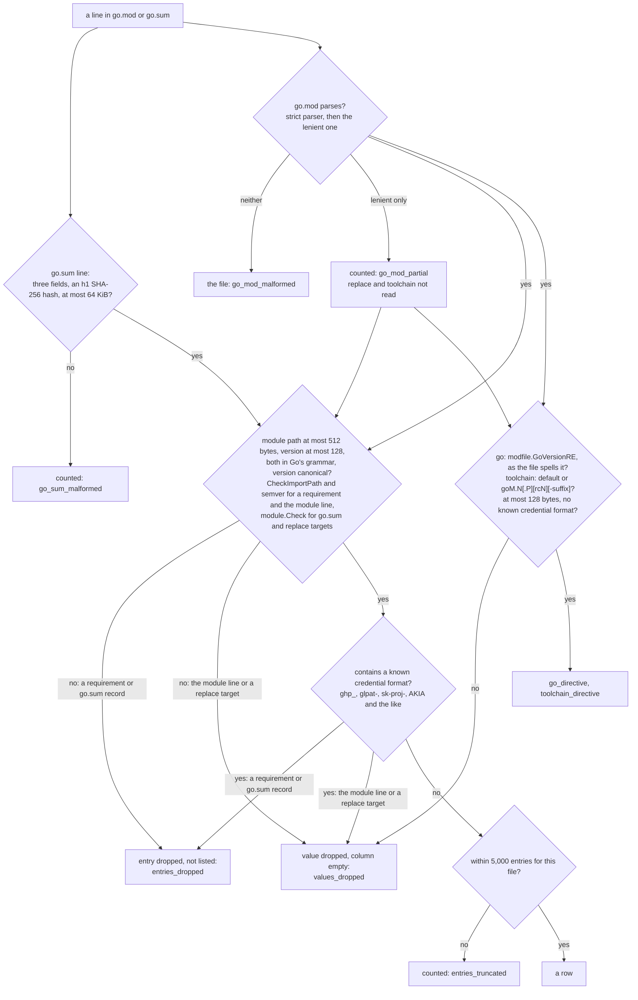

# `go_modules`

One row per Go module version that a project on this host requires in its `go.mod`, records a hash for in its `go.sum`, or both. It is an inventory of declarations and checksum records: what each project's `go.mod` declares and what its `go.sum` records. It does not resolve the dependencies a build uses, and its hashes are records from `go.sum`, not a verification of any installed content. Security uses it to hunt for vulnerable versions when an advisory is published, the developer tools team uses the range of versions in use, and IT and operations use it to clear old versions off machines and to make sure the versions in use can be fetched from the approved module proxy.

Core osquery has no Go module reader. Fleet orbit's `go_binaries` reads the build information embedded in binaries under `~/go/bin` and reports each binary's main module only, so it answers which tools a user installed rather than which modules a project depends on.

## What a row establishes

A row records what a file states, not which version a build uses. Treat it as a candidate to confirm, and confirm it with the go command in that project, such as `go list -m all` or `govulncheck`.

- A `go.mod` requirement declares a minimum version. Minimal version selection can choose a higher one when another module requires it, so a requirement can name a version older than the one compiled in.
- At `go 1.17` and higher, `go.mod` holds an explicit requirement for every module that provides a package to the build. Below `go 1.17`, an indirect dependency appears only when it would otherwise be selected at a different version, so a module the build uses can be absent from `go.mod` and present only in `go.sum`.
- A `go.mod` version is listed as the go command reads it, in canonical form: `v1.2` is listed as `v1.2.0`. A `go.sum` version not in canonical form is dropped. The `retract`, `exclude` and `tool` directives are not read, so a retracted or excluded version that `go.mod` requires is still listed.
- `go.sum` can hold hashes for several versions of one module, and for versions that are no longer needed after an upgrade. `go mod tidy` removes them, and a checkout that was never tidied keeps them.
- A `go.sum` record that hashes only a version's `go.mod` file, shown by `go_mod_hash_recorded = 1` with `module_hash_recorded = 0`, means the go command read that version's requirements during version selection. It does not mean the module's contents were downloaded.
- A build fetches the `go.mod` file of each module version in its module graph and the `.zip` of each module that provides a package, and `go.sum` holds a hash of each. The versions with `module_hash_recorded = 1` or `go_mod_hash_recorded = 1` are therefore the set a module proxy must serve for the project, plus any version an upgrade made unnecessary that `go mod tidy` has not removed.

A query for an advisory therefore produces both kinds of error even when `scan_complete = 1`: a false positive for a requirement or hash older than the version built, and a false negative for a module whose build version appears in neither file. `scan_complete` says the files were read in full, not that they describe the build.

### Comparing versions

osquery's `version_compare()` and `COLLATE version` do not order Go versions the way the go command does, so a range query such as `WHERE version_compare(version, 'v2.0.1') < 0` gives wrong answers. Run on `osqueryi` 5.23.1, against `golang.org/x/mod/semver.Compare`:

| Expression | osquery returns | Go order |
| --- | --- | --- |
| `version_compare('v1.4.2', 'v1.10.0')` | `-1` | `-1`, same |
| `version_compare('v1.4.2-rc.1', 'v1.4.2')` | `1` | `-1`: a pre-release sorts before its release |
| `version_compare('v1.2.3+incompatible', 'v1.2.3')` | `1` | `0`: `+incompatible` does not affect order |
| `version_compare('v2.0.0+incompatible', 'v2.0.1')` | `1` | `-1`: a lower patch stays lower |
| `version_compare('v0.0.0-20250131154556-629f995b6947', 'v0.1.0')` | `-1` | `-1`, same |

The fourth row is the dangerous one: a query for versions older than a patched `v2.0.1` misses `v2.0.0+incompatible`, which is common on modules at v2 and above that predate Go modules, `github.com/docker/docker` among them. Match the exact versions an advisory names, or confirm with govulncheck in the project.

## Sources

The table reads the projects that clients record, then two files in each project. It never walks a directory tree.

| Client | Where it records projects |
| --- | --- |
| VS Code, Code - Insiders, Cursor, Windsurf, VSCodium | the `folder` of each `workspaceStorage/*/workspace.json` under the editor's application-support directory, for the 500 most recently used records, or for a multi-root workspace the `folders` of the `.code-workspace` file the record names |
| GoLand, IntelliJ IDEA, PyCharm and every other JetBrains IDE | the keys of `RecentProjectsManager` in `JetBrains/<product><version>/options/recentProjects.xml` under the application-support directory |
| Claude Code | the keys of `projects` in `~/.claude.json` |
| Codex | the `[projects."<path>"]` tables in `~/.codex/config.toml` |

The lists are read in that order, which is the order Go developers use the clients: the [2025 Go Developer Survey](https://go.dev/blog/survey2025) puts VS Code at 37% and GoLand at 28%, and the coding agents come after the editors. The order decides which projects are dropped when the project cap is reached.

An editor keeps one `workspaceStorage` record for every workspace ever opened and never removes one, so on a long-lived machine most records are for projects nobody has opened in years. The editor writes a record's `state.vscdb` while its workspace is open, which updates the record directory's modification time, so the table reads the 500 most recently modified records per editor, newest first, and counts the older ones in a descriptive `workspace_records_older` row. Only directories are ranked: a file or any other entry beside the records that is not a directory is skipped before the 500 are chosen, so newer entries cannot push a record out, and a record directory that is a symbolic link, or on Windows a junction, is not followed and is counted in `workspace_record_unreadable`. The choice is made fresh on every query, so the records read follow what the user has opened lately. At most 5,000 entries are listed per editor before the 500 are chosen; an editor with more is a `workspace_list_truncated` row, and the 500 come from the entries listed.

A multi-root workspace's record names a `.code-workspace` file, which VS Code documents as JSON with comments and a `folders` array. The file is read when it is inside the home, once however many records name it, with the same refusals as a module file, and its folders count for each editor whose records name it, and up to 100 of its folders are taken, and at most 1,000 from every workspace file in one account's scan. Before it is read, its path gets the cloud-folder rule and its directory the storage probe a project gets: a workspace file stored with a cloud provider, or in a directory on a network or userspace filesystem the home is not on, is counted in `project_in_cloud_storage`, `project_on_network_filesystem` or `project_on_userspace_filesystem`, as one recorded project, and not read. A folder given as a `uri` is contained like a recorded URL, so one on another host is counted as remote. One given as an absolute `path` is contained like any recorded path. One given as a relative `path` is resolved from the file's directory under the rules for a symbolic link's target in [Containment and reads](#containment-and-reads): a leading `..` may climb only as far as the home, and a `..` after a named directory is refused, so both are counted as unusable paths. A workspace file outside the home is counted with the recorded projects outside it, a missing one is silent, and one that cannot be read or parsed, including one that is `null` or whose `folders` is missing or `null`, is counted in `workspace_record_unreadable` or `workspace_record_malformed`. More than 100 folders in one file is a `workspace_list_truncated` row with `limit=100` once all 100 are taken for an editor, and more than 1,000 across the scan one with `limit=1000`, which is the only row for a file the total cut short; once 1,000 are taken, no further workspace file is opened. A workspace file that is a symbolic link is not followed, and is counted in `workspace_record_unreadable`, as a `workspace.json` that is one is.

The application-support directory is `~/Library/Application Support` on macOS, the account's roaming application data on Windows, and `~/.config` on Linux, plus the snap and flatpak locations for the forks that ship in those formats. On Windows a redirected roaming directory is followed when it is inside the profile and reported, not read, when it is outside.

A project-list file that is absent is silent, because most accounts do not use every client. A list file that is a symbolic link to a file in the same home is followed one hop, under the rules in [Containment and reads](#containment-and-reads), as a dotfile manager links one into place. A list file that exists and cannot be read is reported in a warning row for the user, and that includes a list file the read refuses because it is a symlink this table does not follow, or because a component of its path is not a directory: the refusal stays in force, and the projects that list records are reported as missing rather than treated as never recorded. The editor directories the table lists follow the same rule. A `workspaceStorage` directory or the JetBrains directory that is absent, or that has a regular file partway down its path, is silent, because nothing beneath it can exist. One reached through a symlink, at any component, is a `workspace_list_unreadable` or `project_list_unreadable` row with `reason=refused_path`, because the directory exists and the projects it records are lost.

JetBrains documents the per-product configuration directory on each platform but not the `recentProjects.xml` inside it, so the format read is the one GoLand 2026.2 and PyCharm 2026.2 wrote on the development machine. A project path is written with placeholders: `$USER_HOME$` is expanded to the account's home, the IDE's own hidden scratch workspace under `$APPLICATION_CONFIG_DIR$` is skipped, and any other placeholder is reported as an unusable path rather than guessed at. The Toolbox app's own directories beside the products are not read. A `recentProjects.xml` that parses but is not laid out that way, such as one from a release that renames the `RecentProjectsManager` component or its `additionalInfo` map, is reported as an unreadable project list rather than read as a list with no projects. The two forms IntelliJ writes for an empty list, no component and a component with no `additionalInfo`, are silent.

In each recorded project the table reads `go.mod` and `go.sum` at the project root. A project with neither file is silent: most recorded projects are not Go projects, and a project list keeps directories that have since been deleted.

### What the project lists do not cover

- A project that the user never opened in one of the clients above. A Go project worked on only from a terminal is not listed.
- A module that is not at the project root. A repository whose `go.mod` lives in a subdirectory contributes nothing.
- The modules a `go.work` names: workspace discovery is not supported in this version. A project with a `go.work` at its root is counted in a `go_workspace_unsupported` row, whether or not it has a root `go.mod`, so a workspace never looks like a project with no Go dependencies. When the root has a `go.mod`, the root module is listed. A regular `go.work` counts. A symbolic link named `go.work`, a common way to share one, counts when it is followed to a regular file, under the rules in [Containment and reads](#containment-and-reads), and counts unopened when it is not followed, because the link still shows a workspace. A link whose target cannot exist, or that names a directory, does not count, and neither does a directory named `go.work`.
- A recorded project outside the account's home, on another host, or recorded as an unusable path. Each is counted in a `warning` row and not read.
- A recorded project stored somewhere other than this machine's disk: in a cloud storage provider's folder, on a network filesystem or, on Linux, a userspace filesystem such as sshfs or rclone, or with a module file whose content is held by a cloud provider. Such a project is counted in a `warning` row and not read, because reading it would download its content or fetch it over the network, and its content is inventoried where it is stored. A project stored the same way as the home is read: see "Containment and reads".

## Columns

| Column | Content |
| --- | --- |
| `module_path` | the module path |
| `version` | the version the files state: a minimum for a requirement, a hashed version for a `go.sum` record |
| `mod_relationship` | `direct` or `indirect` when `go.mod` requires this version; empty when it does not |
| `replace_module`, `replace_version` | the module and version a `go.mod` `replace` directive substitutes for this requirement |
| `replace_local` | `1` when a `replace` directive substitutes a local directory |
| `project_module` | the project's own module path, from the `module` line of its `go.mod`; empty when the project has no `go.mod` |
| `go_directive` | the `go` line of the project's `go.mod`, such as `1.24.2`: the Go version the project declares; empty when it has none |
| `toolchain_directive` | the `toolchain` line, such as `go1.24.4` or `default`: the toolchain the project asks the go command to use; empty when it has none, and when the `go.mod` was only partially recovered |
| `project_path` | the absolute path of the project directory; empty on a warning row about the user rather than one project |
| `user` | the user's account name, as osquery's `users` table reports it |
| `uid` | the `uid` column of osquery's `users` table, as core osquery's per-user tables publish it, so the table joins with `users` (see "Joining with `users`" for the form to use); on Windows osquery fills it with the last component of the SID, which two accounts can share |
| `user_id` | the uid on macOS and Linux, the whole SID on Windows; empty when it is in neither form |
| `module_hash_recorded`, `go_mod_hash_recorded` | `1` when `go.sum` has a line hashing this version's contents, or its `go.mod` file; `0` when it has none |
| `module_hash`, `go_mod_hash` | the hash on that line, as `h1:` and the canonical base64 encoding of a SHA-256 digest; empty when its `_recorded` column is `0`, or when two lines record different hashes |
| `scan_complete` | `1` (yes) when the project's `go.mod` and `go.sum`, whichever exist, were read in full with nothing left out; `0` (no) otherwise, and on every diagnostic row |
| `warning` | empty on a module row; on a diagnostic row, a fixed sentence for the kind of problem, followed in brackets by whichever details apply (`count=`, `limit=`, `line=`, `reason=` or `source=`), and prefixed with `go.mod:` or `go.sum:` and a space when the problem is in one module file, so `warning LIKE 'go.sum:%'` selects them |

### Column order

The columns run in the order a query writer needs them: the module version a hunt filters on, how `go.mod` declares it, the project and user it was found for, what `go.sum` records for it, and whether the project's listing is complete. Core osquery's package tables lead with the item the same way: `deb_packages` and `npm_packages` start with `name` and `version`, and `vscode_extensions`, a per-user inventory like this one, starts with `name`, `uuid` and `version` and has `uid` near the end. `SELECT *`, `.mode line` and fleet consoles show columns in declared order, so the values a query filters on come first and the long ones, the hashes and `warning`, come last. `mcp_servers` follows the same order: the server, what it runs, the file and user it was found for, then `scan_complete` and `warning`.

A replacement is shown only on the rows of the requirements it governs. A `go.sum` row for a module a `replace` covers keeps empty replacement columns, because `go.sum` records what the go command downloaded, and for a replaced module that is the replacement, which has its own row.

The two files are matched on the exact module path and version, and the hash columns hold what `go.sum` recorded for that module and version. The go command hashes what it downloads, so a requirement that a `replace` directive sends to another module usually has empty `go.sum` columns, and the replacement is listed as its own row with an empty `mod_relationship`; a requirement replaced by a local directory usually has none, because nothing is downloaded. Neither is guaranteed. Adding a `replace` directive does not remove a record `go.sum` already held for the original version, and until something rewrites `go.sum`, such as `go mod tidy`, that record is listed on the requirement's row, where it may predate the replacement. A `go.sum` version that `go.mod` does not require has an empty `mod_relationship`.

`go_directive` and `toolchain_directive` record what a project declares, not the compiler a build used: an installed newer compiler, `GOTOOLCHAIN`, a workspace or a CI image can each change that. They are a first filter for standard-library advisories, which govulncheck reports under the module name `stdlib`, and neither can clear or confirm one on its own. `go_directive` also says how to read the project's `go.mod`: at `go 1.17` and higher it lists every module that provides a package to the build. Both repeat on every row of the project, like `project_module`.

`project_module` separates a project written for the organization from an outside project a developer cloned, by the module path it declares, which is the path that `GOPRIVATE` patterns match. A fork keeps its upstream module path unless someone renames it.

`module_hash_recorded` and `go_mod_hash_recorded` tell an absent record from a conflicting one. `0` means `go.sum` has no line of that kind. `1` with an empty hash means its lines disagree, and the go command trusts neither, so neither is published. A version whose contents are hashed usually has its `go.mod` hashed too, because the go command records both when it downloads a module.

A `replace` with a version on its left applies to that version only and is preferred over one without. A local replacement directory is never published: it is a path the user chose, and the fact an operator needs is that the requirement does not come from a module proxy.

A `go.mod` that fails strict parsing still lists its requirements, recovered with the lenient parser the go command uses for dependencies. Strict parsing fails for a directive a newer Go added and for a malformed directive this version knows, such as a `replace` whose module target has no version. The lenient parser does not read `replace` or `toolchain`, so a `go_mod_partial` row reports the line, and the replacements and `toolchain_directive` are not listed.

Two `replace` directives that send the same module, or the same module and version, to different targets are a conflict, and the go command refuses the file. No target is more correct than the other, so a requirement a conflicted directive governs is listed without a replacement and a `go_mod_replace_conflict` row reports the count. Directives that repeat one target are not a conflict, and a version-specific directive beside a wildcard one for the same module is not either.

### What `scan_complete` means

`scan_complete`, like every yes-or-no column in this table and in core osquery, is an INTEGER: `1` means yes and `0` means no. On a module row, `scan_complete = 1` means the table read that project's `go.mod` and `go.sum`, whichever exist, to the end, and left nothing in them out. So if a project's `go.sum` records 40 versions and its rows read `scan_complete = 1`, all 40 are in the table. Every diagnostic row reads `0`.

`scan_complete = 0` on a module row means that project's own listing is short, for one of these reasons. A finding about one module file is reported in a warning row that names the project and the file; a cap, the time budget or a cancelled query is reported in a warning row for the user:

- a module file could not be read, is over the size cap, is a symbolic link this scan did not follow beside a readable other file, or was refused by a safety check (a hard link, or on Linux a FUSE filesystem);
- a `go.sum` line is not three fields, has a hash that is not an `h1` SHA-256 digest, or records a version with two different hashes; `h1` is the only hash algorithm the go command supports, so a line using another is counted rather than trusted;
- an entry or a value was dropped, or an entry was past the per-file cap (see "How an entry is checked");
- the `go.mod` was only partially recovered (`go_mod_partial`), or has conflicting `replace` directives;
- the query's row cap, byte cap or time budget, or its cancellation, stopped partway through that project.

A file that is absent is not a reason: a project with no `go.sum` has rows with empty `go.sum` columns, and they read `scan_complete = 1`.

`scan_complete` does not describe the user's other projects. A problem finding a user's projects, such as an unreadable `~/.codex/config.toml`, a project directory that could not be opened, the project cap, the time budget running out before a project was reached, or an unreadable home, is reported as a warning row for that user, with `project_path` empty. It does not change the rows of the projects that were read. So a user's inventory is complete when that user has no warning rows other than the descriptive ones (`project_outside_home`, `project_remote_origin`, `project_path_malformed`, `project_in_cloud_storage`, `project_on_network_filesystem`, `project_on_userspace_filesystem`, `workspace_records_older` and `go_workspace_unsupported`), which describe what the table reads rather than something it failed to read. On a host with one user, that means the result has no other warning rows.

Every descriptive sentence starts with "recorded project", and no other sentence does, so one predicate separates them. The users with an incomplete inventory, in a query with no `project_path` constraint, are:

```sql
SELECT DISTINCT user FROM go_modules
WHERE warning != '' AND warning NOT LIKE 'recorded project%';
```

### How an entry is checked

Every `require` line and every `go.sum` line, the `module`, `go` and `toolchain` lines, and every `replace` target pass through these checks before they reach a column. Nothing that fails is published altered. A requirement or a `go.sum` record that fails is an entry: it is left out and counted in `entries_dropped`. A replacement target or the `module`, `go` or `toolchain` line that fails is a value on rows that are still listed: its column is left empty and it is counted in `values_dropped`.



The go command never writes a line that fails these checks, so in practice a dropped entry or value means a hand-edited or crafted file:

| Dropped from | Example | What happens | Counted in |
| --- | --- | --- | --- |
| a `go.mod` `require` | `require "--token=abc123" v1.0.0`: the parser accepts any quoted string as a path | the requirement is not listed | `entries_dropped` |
| a `go.mod` `require` | `require example.com/ghp_<36 characters> v1.0.0` | the requirement is not listed | `entries_dropped` |
| a `go.sum` line | `local/lib v1.0.0 h1:…`, `example.com/lib/v2 v1.0.0 h1:…` (the version disagrees with `/v2`), `github.com/f/six notaversion h1:…` | the version is not listed, counted once even when both its lines fail | `entries_dropped` |
| a `go.sum` version | `v1.0.0+opaqueSecret123` or `v1.2`: valid semver, but not the canonical form the go command writes, so build metadata could carry text a user chose and `v1.2` would not match `v1.2.0`. A `go.mod` version is read in canonical form instead, as `v1.0.0` and `v1.2.0` | the entry is not listed | `entries_dropped` |
| the `go.mod` `module` line | `module "example.com/a --token=x"` | `project_module` is empty on every row | `values_dropped` |
| the `go.mod` `module` line | a module path of 1 MiB, which the grammar allows because it sets no length limit, and which `project_module` would repeat on every row of the project | `project_module` is empty on every row | `values_dropped` |
| a `replace` target | `replace example.com/dep => local/fork v1.0.0`: a downloaded module needs a dot in its first path element | the requirement is listed without the replacement | `values_dropped` |
| the `go` line | `go 1.24+--token=x`: the strict parser rejects it and the lenient parser shortens it to `1.24`, so the line as the file spells it does not match | `go_directive` is empty on every row | `values_dropped` |
| the `toolchain` line | `toolchain go1.21.0-ghp_<36 characters>`: `modfile` checks only that a toolchain starts with `go1.` | `toolchain_directive` is empty on every row | `values_dropped` |

An invalid version in `go.mod` is not dropped on its own: the parser rejects the whole file, as the go command does, and the file is reported as `go_mod_malformed`. Any of these marks that project's rows `scan_complete = 0`, because the table can no longer promise that every entry the file lists is in the result.

### Warning codes

Every warning row holds one sentence from a fixed list in `warnings.go`, followed by details in brackets, such as `[count=4]` or `[reason=denied]`. The code names below are the identifiers this documentation and the source use; the column publishes the sentence, so a query selects a kind of warning with `LIKE` on the sentence's opening words, or on the `go.mod:`/`go.sum:` prefix. Every warning row reads `scan_complete = 0`.

The terms the sentences use:

| Term | Meaning | Codes |
| --- | --- | --- |
| skipped | a `go.sum` line not in the module, version and hash form, so it cannot be read as an entry | `go_sum_malformed` |
| dropped | a requirement or `go.sum` record (an entry), or a replacement target or the `module`, `go` or `toolchain` line (a value), that parsed and is outside its grammar, not in the canonical form the go command writes, longer than 512 bytes (128 for a version or a toolchain), or contains a known credential format. A dropped entry is not listed; a dropped value leaves its column empty on rows that are still listed | `entries_dropped`, `values_dropped` |
| truncated, past the limit | an entry or a list item beyond a cap | `entries_truncated`, `project_list_truncated`, `workspace_list_truncated`, `row_limit_reached_*`, `output_size_reached_*` |
| partially recovered, lenient parsing | a `go.mod` the strict parser rejected, read again with the lenient parser the go command uses for dependencies' `go.mod` files: its requirements are listed, and its `replace` directives are not read | `go_mod_partial` |
| refused | a file the read declined to open: a symbolic link it did not follow, a hard link, or a file on a Linux FUSE filesystem | `source_link_refused`, `project_read_refused`, `project_userspace_filesystem` |
| not read, not inspected | a project or user outside what this table reads, or one it did not reach | the descriptive codes, and the codes about a user that was not scanned |

**About one project's files.** `project_path` names the project, and the sentence starts with `go.mod:` or `go.sum:` and a space. That project's module rows read `scan_complete = 0`.

| Code | Sentence | Details |
| --- | --- | --- |
| `source_unreadable` | this module file could not be read, so what it records is missing from this project's rows | `reason=`, the failure class |
| `source_too_large` | this module file is larger than the limit this scan reads, so what it records is missing from this project's rows | `limit=`, in bytes |
| `source_link_refused` | this module file is a symbolic link this scan did not follow, so what it records is missing from this project's rows | none |
| `project_read_refused` | a module file in a recorded project was refused by a safety check rather than being absent, so it exists and was deliberately not read | `reason=hard_link` |
| `project_userspace_filesystem` | a module file in a recorded project is on a filesystem implemented in userspace, where a read may fetch its contents on demand, and was not read | `count=1` |
| `go_mod_malformed` | this go.mod could not be parsed, so its requirements and replacements are missing from this project's rows | none |
| `go_mod_partial` | this go.mod did not pass strict parsing; its requirements were recovered and are listed, and its replace directives were not read | `line=` |
| `go_mod_replace_conflict` | replace directives in this go.mod send the same module to different targets, which the go command refuses; the requirements they govern are listed without a replacement | `count=` |
| `go_sum_malformed` | lines in this go.sum are not in the module, version and hash form and were skipped | `count=` |
| `go_sum_checksum_conflict` | this go.sum records different hashes for the same module version, which the go command treats as a record it cannot trust; the module version is still listed, without that hash | `count=` |
| `entries_dropped` | entries in this file have a module path or version outside the Go module grammar, longer than this table publishes, or containing a known credential format, and are not listed | `count=` |
| `values_dropped` | values in this go.mod, a replacement target or the module, go or toolchain line, are outside their grammar, longer than this table publishes, or contain a known credential format, so they are not published and the rows are listed with that column empty | `count=` |
| `entries_truncated` | this module file lists more entries than this scan reads, so entries past the limit are not listed | `limit=` |

**About finding the user's projects.** `project_path` is empty. Module rows are unchanged, except that the project a `_during_home` code stopped partway through reads `scan_complete = 0`.

| Code | Sentence | Details |
| --- | --- | --- |
| `project_list_unreadable` | the list of projects this client records could not be read, so those projects are not listed | `source=`, the client's list (`claude_json`, `codex_toml` or `jetbrains_recent`); with `reason=`, the failure class, when the file could not be read, `count=` for unreadable or unfamiliar JetBrains lists, and nothing more when `~/.claude.json` or `~/.codex/config.toml` could not be parsed or `~/.claude.json` is `null` |
| `project_list_truncated` | the list of projects this client records was longer than this scan will follow, so projects past the limit were not inspected | `count=`, `limit=`; `source=jetbrains_recent` when the JetBrains product directories were capped, and no source when the 1,000-project cap across every client was reached |
| `project_directory_unreadable` | project directories this account recorded could not be opened, so their module files were not read | `count=`, `reason=`: one row per reason, such as `denied` for a directory macOS protects when `osqueryd` lacks Full Disk Access |
| `workspace_list_unreadable` | an editor's workspace list could not be read, so the projects it records are not listed | `reason=`, `source=`: `vscode_workspace`, `cursor_workspace` or `windsurf_workspace` |
| `workspace_list_truncated` | an editor's workspace list held more entries than this scan reads, so projects past the limit are not inspected | `count=`, `limit=`, `source=`: `limit=5000` for a `workspaceStorage` directory, `limit=100` for one `.code-workspace` file's folders, `limit=1000` for every workspace file's folders together |
| `workspace_record_unreadable` | workspace records exist and could not be read, so the projects they name are not listed | `count=` |
| `workspace_record_malformed` | workspace records could not be parsed, so the projects they name are not listed | `count=` |
| `appdata_undetermined` | the roaming application data location could not be determined for this account, so projects its editors record may not be listed; the conventional location was inspected instead | none |
| `appdata_redirected_outside_profile` | roaming application data for this account is redirected outside the profile, which is not inspected, so projects its editors record are not listed | none |
| `budget_exhausted_during_home` | the query budget was exhausted part way through this account, so some of its projects may not be listed | none |
| `cancelled_during_home` | the query was cancelled part way through this account, so some of its projects may not be listed | none |
| `row_limit_reached_during_home` | the query reached the number of module rows this table returns part way through this account, so some of its modules are not listed | `limit=` |
| `output_size_reached_during_home` | the query reached the number of bytes this table returns part way through this account, so some of its modules are not listed | `limit=`, in bytes |

**About a `project_path` the query names.** Only a query with a `project_path` equality constraint gets these, one for each named path no row matches as published. `project_path` holds the named path exactly as the query wrote it. A user's inventory is not described by them, so the incomplete-inventory query above is for a query with no `project_path` constraint.

| Code | Sentence | Details |
| --- | --- | --- |
| `project_path_not_published_form` | the project_path this query names is not written as project_path publishes it, an absolute path with no trailing separator and no . or .. component, so no row can match it and nothing was read for it | none; `user` is empty, or each user a `user` constraint names |
| `project_path_without_rows` | no module row matches the project_path this query names, which is inside this account's home: the directory has no go.mod or go.sum, or its module files were not read; the same query without the project_path constraint shows any warning about it | none |
| `project_path_outside_scanned_homes` | the project_path this query names is not inside the home of any account this query scanned, so nothing was read for it | none; `user` is empty, or each user a `user` constraint names |

**About a user that was not scanned.** `project_path` is empty, and the user has no module rows. The exception is `roster_account_unnamed`, which a constrained query receives under each user it asked about, whether or not that user was scanned, because the account the roster could not name may be any of them.

| Code | Sentence | Details |
| --- | --- | --- |
| `roster_unreachable` | osquery could not be reached to list user accounts, so no account's projects were inspected | none |
| `roster_query_failed` | the osquery users table could not be read, so no account could be confirmed or ruled out | none |
| `roster_account_unnamed` | the roster returned an account with no username, so it could not be attributed or inspected and this account may be it | none |
| `account_not_inspected` | this account was not inspected; the reason gives the roster's explanation | `reason=`, the roster's reason |
| `accounts_home_unusable` | accounts with no usable home directory were not inspected; query a specific user to see which | `count=` |
| `account_not_in_roster` | no account of this name is in the roster osquery returned, so nothing was scanned for it: the name may be misspelled, the account may have been removed, or it may be one the roster does not enumerate | none |
| `home_unreadable` | this account's home directory could not be opened, so none of its projects are listed | `reason=`, the failure class |
| `budget_exhausted_before_home` | the query budget was exhausted before this account was scanned, so none of its projects are listed | none |
| `cancelled_before_home` | the query was cancelled before this account was scanned, so none of its projects are listed | none |
| `row_limit_reached_before_home` | the query reached the number of module rows this table returns before this account was scanned, so none of its modules are listed | `limit=` |
| `output_size_reached_before_home` | the query reached the number of bytes this table returns before this account was scanned, so none of its modules are listed | `limit=`, in bytes |

**Descriptive: what the table reads.** `project_path` is empty. These describe the scope of the table, not a failure, so a user whose only warnings are these has a complete inventory.

| Code | Sentence | Details |
| --- | --- | --- |
| `project_outside_home` | recorded projects lie outside this account's home and were not inspected | `count=` |
| `project_remote_origin` | recorded projects are on another host rather than this filesystem and were not inspected | `count=` |
| `project_path_malformed` | recorded project locations were not usable absolute paths and were not inspected | `count=` |
| `project_in_cloud_storage` | recorded projects are stored with a cloud storage provider rather than on this machine's disk and were not read, so nothing was downloaded | `count=` |
| `project_on_network_filesystem` | recorded projects are on a network filesystem, unlike this account's home, and were not read, so nothing was read over the network | `count=` |
| `project_on_userspace_filesystem` | recorded projects are on a filesystem implemented in userspace, unlike this account's home, where a read may fetch their contents on demand, and were not read | `count=` |
| `workspace_records_older` | recorded project records older than the most recently used ones this scan reads were not inspected | `count=`, the records not read, summed across the directories one editor has; `limit=500`; `source=` |
| `go_workspace_unsupported` | recorded projects have a go.work file, and workspace discovery is not supported in this version: a module at the project root is listed, and the other modules the workspace names are not | `count=` |

## What reaches a column

Every column holds a value from a closed set, an integer, a value checked against the Go module grammar or, for `go_directive` and `toolchain_directive`, their own grammars, a `go.sum` hash in its fixed form, the account's name and identifiers as osquery's `users` table reports them, or the project path.

- **Module paths and versions** are at most 512 and 128 bytes, and must pass the Go team's own grammar from `golang.org/x/mod`. The grammar sets no length limit, and `project_module` is repeated on every row of its project, so without the caps one 1 MiB `module` line in a `go.mod` under the size cap would publish gigabytes; the longest module path in the development machine's module cache is 65 bytes. A `go.sum` record and a replacement that names a module and version describe a module the go command downloads, so they must pass `module.Check`: a dot in the first path element, and a version that agrees with any major-version suffix, so `example.com/lib/v2` with `v1.0.0` is refused. A requirement must pass `module.CheckImportPath` and `semver.IsValid`, which admit a module with no dot when a `replace` points it at a local directory; the `go.mod` parser already enforces a requirement's major-version pairing. This check is what stops a crafted value: the `go.mod` parser accepts any quoted string as a module path, including one holding a credential assignment. A value that passes the grammar but contains a known credential format, such as `ghp_` followed by thirty-six characters, is dropped too: the parser never resolves a module path, so the grammar alone does not keep a token out. The check uses only formats ordinary names do not share, so `github.com/acme/sk-payments-service-client` and `github.com/acme/gitlab-ci-pipeline-exporter-tools` are listed; the bare `sk-` and `gitlab-` patterns apply to `project_path` only. An entry that fails is counted in an `entries_dropped` row and not published, so nothing published differs from what the file states.
- **Hashes** must be `h1:` followed by the canonical base64 encoding of a 32-byte digest, the form the go command writes, checked when the line is parsed and again when the row is published. An encoding whose padding bits are not zero names the same bytes but is not that form, and its line is counted as malformed.
- **The project's module path** passes `module.CheckImportPath`, as a requirement does; a `module` line outside the grammar is counted in a `values_dropped` row and the column is empty.
- **The `go` and `toolchain` lines** are not module paths or versions, so they have their own grammars: `go` must match `modfile.GoVersionRE` as the file spells it, and `toolchain` must be `default` or `go` followed by a major and a minor version, optionally a patch version, a pre-release such as `rc1`, and a `-` suffix of letters, digits, dots, underscores or dashes, which is narrower than `modfile`'s own check that a toolchain starts with `go1.`. Both are at most 128 bytes and pass the credential check. A line that fails is counted in a `values_dropped` row and its column is empty.
- **The project path** is the one value with no grammar, because a user names their directories. The module grammar is not a guarantee against free text either: a path element or a pre-release identifier can still be an opaque string a user chose, and only the distinctive credential formats are dropped. A recorded project whose absolute path is longer than 1,024 bytes, macOS's `PATH_MAX`, is counted in `project_path_malformed` and not read, so no row carries a longer one. It is redacted for issuer token formats and for assignments whose option name announces a credential, and it is emptied unless it is absolute, clean and inside the home it was found in. A directory that a user names after an opaque secret still reaches the column. The redaction and the emptying mean `project_path` is not a unique key: two projects whose paths redact to the same text, or that are both emptied, publish the same value. The one exception to the rule is the three warning rows about a path a `project_path` constraint names, which carry that path as the query wrote it: it is the query writer's own text, not a byte any scanned account chose, and a path redaction would change gets no such row.
- **The warning column** holds a fixed sentence the table defines for each kind of problem, integers, values from closed sets, and the file-name prefix, which is `go.mod` or `go.sum`. No parser or filesystem error text reaches it, because that text can quote the file or the path.

## Containment and reads

A recorded project's path is contained in the home by comparing its components with the home's. The comparison folds case on macOS and Windows, whose default filesystems are case-insensitive, so `/users/alice/code` is a project under the home `/Users/alice`; on a case-sensitive APFS volume such a path is read through the home's spelling, still inside the home. Two recorded spellings of one directory that differ only in case are one project there, read once under the spelling read first: Codex records every project key in lowercase on Windows, so a project Codex and another client both record arrives in two spellings. On Windows a UNC path, `\\server\share` or `//server/share`, names another host and is counted in `project_remote_origin`. Every read opens each path component from the home down with symlinks refused, through `pkg/fsscan`. A module file is also refused when it has more than one hard link, because a hard link to another account's file passes every path check, and, on Linux, when it is on a FUSE filesystem, because a read there is served by a userspace process and can stall or fetch over the network. On macOS and Windows no filesystem-type check for userspace filesystems is implemented, so one whose files carry no cloud attribute is read.

**A module file or `go.work` that is a symbolic link** is followed one hop on macOS and Linux when the file it names is in the same home, because a `go.sum` or `go.work` shared between checkouts by a link is a common setup, and refusing it would mark those projects incomplete. The link is read with `readlinkat` relative to the project directory, which was opened with symlinks refused, and its target is resolved against that directory as text. The target's directory first passes the checks a project directory passes, in the same order and before anything under it is opened: the cloud-folder rule on its path, then one probe of the directory. The target is then opened like any module file, from the home down with symlinks refused, so every check in this section applies to it. A link is not followed when its target:

- is outside the home. `osqueryd` runs as root or SYSTEM and reads homes it does not own, so following a link out of the home would let a user point it at another account's files or the system's;
- climbs above the home with leading `..` components, even to come back down into it, because the home's own path was never opened one component at a time;
- has a `..` after a named directory, as in `vendor/../go.sum`. The kernel resolves that `..` from wherever `vendor` points, which the text cannot show, so the file read could differ from the file the go command reads. A leading `..`, as in `../shared/go.sum`, is resolved from the project directory, which has no symlink on its path;
- is in a cloud storage provider's folder, decided from the path before anything is opened (item 1 below);
- is in a directory on a network filesystem, or on Linux a userspace filesystem, that the home is not on, by the rule that counts a project stored there instead of reading it (item 2 below), or in a directory the probe cannot open or reaches through a symlink;
- is itself a symbolic link, so a chain is never walked, is not a regular file, or has its content held by a cloud provider. The project itself is local, so its other module file is still listed.

A link whose target cannot exist, because the target is missing, its directory is missing, or a component of its path is a regular file, is an absent file, as a dangling link is. A target with more than one hard link is refused as a hard link, and one over the size cap is too large. A link that is not followed is a `source_link_refused` row when the project's other module file was read, and silent otherwise, like a project directory that is a symlink, which is still not followed.

The project lists, `~/.claude.json` and `~/.codex/config.toml`, are followed under the same rules, with the home as the link's directory or `~/.codex`. A list link that is not followed is a `project_list_unreadable` row, and so is one whose target's content a cloud provider holds. A list file that is not a link but whose content a provider holds is a `project_list_unreadable` row with `reason=cloud_placeholder`. A symlinked `~/.codex` directory is not a link to a file, so it is refused, and so are a `workspace.json` and a `.code-workspace` file, which are counted in `workspace_record_unreadable`.

**On Windows, a symbolic-link module file is never followed,** wherever it points, and is reported as above. This is a gap in this implementation, not a limit of the platform: Go 1.25's `os.Root.Readlink` reads a link through a handle opened relative to its directory, as `readlinkat` does. What is missing is a Windows link reader in `pkg/fsscan`, and containment rules for target forms POSIX does not have: `\shared\go.sum` is rooted on the current drive and `D:go.sum` is relative to a drive's current directory, and neither is absolute to `filepath.IsAbs`, so resolving either against the link's directory would name the wrong file. A junction, the Windows link that needs no privilege, can only point at a directory, so a linked module file on Windows is a symbolic link, which needs a privilege or Developer Mode to create.

A project stored somewhere other than this machine's disk is not read at all, and each check runs at the first point it can be answered:

1. A project in a cloud storage provider's folder is decided from its path, before anything is opened: `~/Library/CloudStorage` and `~/Library/Mobile Documents` on macOS, and `OneDrive`, `Dropbox`, `Google Drive` and `iCloudDrive` in the Windows profile.
2. A project on a network filesystem, or on Linux on a userspace filesystem such as sshfs or rclone, is decided by opening its directory once, before any file in it: the directory's filesystem is not marked local (`MNT_LOCAL`) on macOS, or is NFS, SMB, CIFS, CephFS, AFS or FUSE on Linux. 9p is not counted, because WSL2 mounts the Windows drives over it and developers keep projects there. The home is probed the same way once, and a project stored the same way as the home is read rather than counted: a home on a network filesystem, as in many managed fleets, is where its user works, and its client lists are already read there, so skipping its projects would inventory nothing for that user. A project on FUSE under a FUSE home still meets the per-file FUSE refusal above. Windows needs no check, because a folder redirected to a share leaves the profile and is refused by containment.
3. A project with a module file whose content is held by a cloud provider, which the file's own attribute reports (`SF_DATALESS` on macOS, the recall attributes on Windows), is dropped when that file is opened, and its other file is not read, because a listing from one file would misdescribe the project.

Each is counted in one descriptive `warning` row per account. The row says what happened; the reason is that reading such a project would download its content or fetch it over the network during a scheduled query, and its content is inventoried where it is stored.

## Size caps

The largest Go manifests measured on the development machine are Fleet's: a `go.sum` of 1,218 lines and 115 KB holding about 600 distinct module versions, and a `go.mod` of 395 lines. Each cap sits well above that, and reaching one is reported rather than silent.

| What | Cap | When it is reached |
| --- | --- | --- |
| `go.mod`, `go.sum` | 2 MiB | the file is not read; a `source_too_large` row |
| entries from one file | 5,000 | the rest of the file is not listed; an `entries_truncated` row, and the file's rows are incomplete |
| module rows in one query, one per module version per project | 50,000 | the user being read stops: the project it stops in keeps the rows that fit, marked incomplete, a `row_limit_reached_during_home` row reports it, and each user after it gets a `row_limit_reached_before_home` row |
| bytes of module rows in one query, each row measured as it is published, its column names and its values after redaction, at the most they take as a JSON object | 32 MiB | as for the row cap, reported as `output_size_reached_during_home` and `output_size_reached_before_home`; when both caps are spent at once, both are reported |
| one `go.sum` line | 64 KiB | the line is counted in `go_sum_malformed` and the rest of the file is listed |
| `~/.claude.json` | 4 MiB | the list is not read; a `project_list_unreadable` row |
| `~/.codex/config.toml`, each `workspace.json`, each `recentProjects.xml`, each `.code-workspace` | 1 MiB | the file is not read; a `project_list_unreadable` row for `config.toml` or a `recentProjects.xml`, or a `workspace_record_unreadable` count for a `workspace.json` or a `.code-workspace` |
| folders taken from one `.code-workspace` file | 100 | the rest are not inspected; a `workspace_list_truncated` row with `limit=100` |
| folders taken from every `.code-workspace` file in one account's scan | 1,000 | the rest are not inspected; a `workspace_list_truncated` row with `limit=1000` |
| JetBrains product directories per user | 128 | products past the cap are not read; a `project_list_truncated` row |
| a recorded project's absolute path | 1,024 bytes | the project is counted in `project_path_malformed` and not read |
| recorded projects per account, counting each distinct directory once across every client | 1,000 | projects past the cap are not inspected; a `project_list_truncated` row |
| `workspaceStorage` records read per editor | 500, the most recently modified directories | older records are not read; a descriptive `workspace_records_older` row |
| `workspaceStorage` entries listed per editor | 5,000 | entries past the cap are not listed, and the 500 are chosen from those listed; a `workspace_list_truncated` row |

## Output size

Measured on the rows Fleet's root module produces, a row carries about 190 bytes of values and about 470 bytes as a JSON object with its column names, before the fields osquery's logger adds to each result. So 1,000 rows is about 0.4 MiB of JSON, 10,000 rows about 4.5 MiB, and the 50,000-row cap about 22 MiB. The caps bound the extension's work; they are not set to fit a log pipeline. A query writer concerned about a transport limit or the volume reaching a SIEM can reduce it:

- `WHERE user = '<name>'` reaches the table, so only that account is read, and the output shrinks with the work.
- `WHERE project_path = '<path>'` reaches the table too, so only the named directories are read; see [Narrowing by project](#narrowing-by-project). A filter on `project_module` or `module_path`, or on `project_path` other than by equality, is applied by SQLite after the scan: the output shrinks, the work does not.
- Leaving out `module_hash` and `go_mod_hash` removes about half of each row's values.
- A scheduled query in osquery's default differential mode logs only the rows added or removed since its last run, so after the first run the volume follows change rather than the size of the inventory.

Scan time and output grow with the recorded projects, and the caps bound them separately: the project cap bounds the work, and the row and byte caps bound the module rows whatever the project cap is. Diagnostic rows are kept whatever those caps, so that a stopped scan still says what it missed; they are bounded instead by the project cap and the path cap. A project yields at most eight finding rows, four per module file, each with a `project_path` of at most 1,024 bytes, so a user whose 1,000 recorded projects each carry every finding produces about 13 MB of them. The byte cap, 32 MiB, sits above the realistic output at the row cap, so it binds only when rows are unusually long, as a crafted manifest can make them. `BenchmarkDiscoverRecordedProjects` in `bench_test.go` measures one user with 200 and with 1,000 recorded projects, one in ten a Go project with 20 requirements, one in ten deleted, and the rest holding neither file. On an Apple M4 Pro with a warm file cache, a scan took about 50 ms and 245 ms, and produced 400 and 2,000 rows, about 0.25 MB and 1.26 MB of JSON. The fixture's temporary directories make each `project_path` longer than a real one, so real rows are somewhat smaller. A first scan with a cold cache takes longer.

## Query budget

One time budget covers every account in a query, set by `MACADMINS_EXTENSION_WALK_TIMEOUT` and 60 seconds by default. An account the budget does not reach gets a row saying so rather than no rows. The budget is cooperative: it is checked before each list read, directory probe and file read, and it does not interrupt an operation already under way. A read that blocks, such as one on a hung network mount, holds the query until it returns. On macOS and Linux, osquery's own `--thrift_timeout`, 300 seconds by default, bounds how long `osqueryd` waits for the extension. On Windows it does not apply, because osquery's Windows pipe transport has no timeout.

## Accounts that share a home

Two accounts in osquery's `users` table can have the same home directory: on macOS, `root` and `daemon` both have `/var/root`, and Linux service accounts often share `/var/empty` or `/nonexistent`. The table scans each home once and reports its rows under every account that has it.

A home already scanned in full is reused for the next account that shares it before the caps and the deadline are consulted, as long as its rows fit what the caps have left. Reusing it is no filesystem work, and the answer is complete: the second account's inventory is exactly the first's. So once a cap is spent, or after the deadline, an account whose shared home holds no Go projects gets no rows and no warning, which is the true answer; a `_before_home` row would say modules went unlisted when there were none. A scan a cap stopped is not reused, because it is one account's share of the output, and the next account sharing the home is told the cap was reached before its scan. A scan the deadline stopped is reused with its `budget_exhausted_during_home` row, because it is the same partial scan of the same directory. That happens only within one query, for an account later in uid order that shares the home, after the deadline cut the first account's scan short; every other account reached after the deadline gets `budget_exhausted_before_home`. A scan a cancelled query stopped is never reused, because cancellation is checked first. On Windows, accounts share a home only when they also share a SID, because each account's registry hive is read too.

Two results of this depend on order, and the order is uid order, so they are the same on every run over an unchanged host:

- Once a cap is spent, a shared home already scanned and known to hold nothing gets no row, and a home not yet scanned gets a `_before_home` row, because until it is scanned the table cannot know it is empty.
- A home already scanned in full whose rows do not all fit what the caps have left is not cut: the account gets only the `_before_home` row, where a first scan of the same home would have kept the rows that fit and marked the project it stopped in incomplete. The caps bound the output of a query; they do not divide it between accounts.

A query that reaches a cap or the budget is one to narrow, for example to one account with `WHERE user = '<name>'`, in the same way a scheduled query is kept within osquery's watchdog limits so the watchdog does not denylist it. The warning rows say whether a result is complete.

## Narrowing by user

`WHERE user = 'alice'` reaches the table as an equality constraint and only that account is read. A query that mixes `=` with another operator on `user` reads every account and lets SQLite filter, because the constraint list cannot prove the equality values are the whole answer. A requested account that the roster does not contain gets an `account_not_in_roster` row.

## Narrowing by project

`WHERE project_path = '/Users/alice/code/svc'` reaches the table as an equality constraint, and only the named directory is read. No client's list is read, so a project opened only from a terminal, which no list records, is listed when it is named. A home that contains none of the named paths is not opened. A named path goes through the checks a recorded project does: containment in the home, the 1,024-byte path cap, the storage checks, and the caps on rows and bytes.

- Only the published form matches. SQLite still compares each row's `project_path` with the literal, so the literal has to be what the column publishes: absolute, clean, with no trailing separator, using the roster's spelling of the home (`/var/...` where the roster says so, not `/private/var/...`) in its exact case, and unchanged by redaction. A path that differs from the home only in letter case is not read for and gets `project_path_outside_scanned_homes`, although macOS and Windows find it inside the home, because the rows read for it would publish the roster's spelling, which the filter drops. A path that redaction changes, or one this table empties, never matches.
- Rows about the user, such as an unreadable list, have an empty `project_path`, so a `project_path` constraint drops them, as it does on a full scan. `project_path = ''` selects exactly those rows, so it reads every list.
- A finding about one of the named project's module files keeps its `project_path`, so it is returned with the project's rows.
- A named path that no published `project_path` can equal is not read for. One not written in the published form, relative or with a trailing separator, `.` or `..`, gets a `project_path_not_published_form` row. One that redaction would change gets no row, because carrying it would publish what redaction removes, and a row carrying anything else is one the filter drops; the same query without the constraint shows the project's rows, under the redacted path.
- A named path in the published form that no row matches gets a warning row that carries the path exactly as the query wrote it, so the filter keeps it; see "About a `project_path` the query names" under "Warning codes". A path inside an account's home gets `project_path_without_rows` under each such account with no row at it, so two accounts that share a home are answered separately, and any other path gets `project_path_outside_scanned_homes`, with an empty `user`, or under each user a `user` constraint names. A literal longer than 1,024 bytes, which no row can carry, gets no row and is not read for.
- Equality only, and all of it or none, as for `user`.

## Joining with `users`

Put this table first and join with `LEFT JOIN`. SQLite keeps the left side of a `LEFT JOIN` as the outer loop, so the table is scanned once, and every row of the table is kept, including the diagnostic rows about no single account, such as `accounts_home_unusable`, which have no `uid`:

```sql
SELECT u.username, u.description, t.*
FROM go_modules t LEFT JOIN users u USING (uid);
```

On Windows, `uid` is the last component of the SID, which two accounts can share, so join on the whole SID, which `user_id` holds and osquery's `users` table reports as `uuid`:

```sql
SELECT u.username, u.description, t.*
FROM go_modules t LEFT JOIN users u ON u.uuid = t.user_id;
```

With a plain `JOIN`, SQLite may put this table on the inner side and run the whole scan once for each `users` row, because `uid` is not pushed down to the read. Measured with osqueryi 5.23.1 on a development Mac with 133 rows in `users`, `FROM users JOIN go_modules USING (uid)` ran 133 scans in about 42 seconds, against one scan in under a second for the `LEFT JOIN` form. Joining on `user` costs the same and adds rows: each scan is constrained to one name, so every service account the join reaches gets a row saying it was not inspected. A `CROSS JOIN` with the table first also scans once, but as an inner join it drops the rows that have no `uid`.
